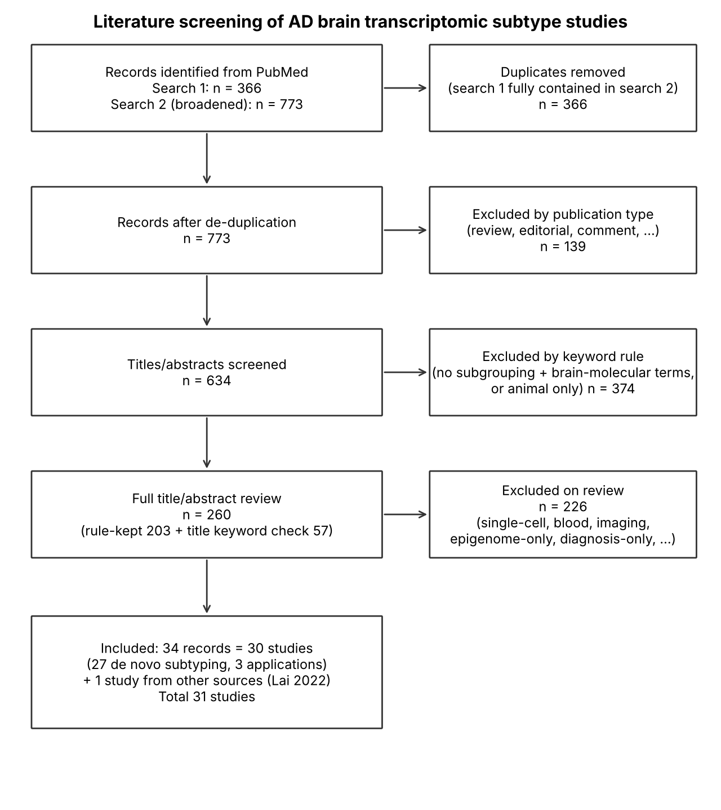

# AD 뇌 전사체 아형 선행연구 검색과 비교표 (2026-11-17 갱신)

## PRISMA 선별 결과 (PubMed, 2026-11-17)


**검색식 (PubMed, 2026-11-17 실행, 773건)**
```
("Alzheimer Disease"[MeSH] OR alzheimer*[tiab]) AND (subtyp*[tiab] OR "molecular subgroup*"[tiab] OR stratif*[tiab] OR heterogeneity[tiab] OR cluster*[tiab] OR taxonomy[tiab]) AND (transcriptom*[tiab] OR "gene expression"[tiab] OR "RNA-seq"[tiab] OR microarray*[tiab] OR multi-omic*[tiab]) AND (brain[tiab] OR cortex[tiab] OR hippocamp*[tiab] OR postmortem[tiab] OR "post-mortem"[tiab] OR ROSMAP[tiab] OR MSBB[tiab] OR "Mayo"[tiab]) AND ("2015"[dp] : "2026"[dp])
```
검색 1(366건)은 위 식에서 heterogeneity, cluster*, taxonomy와 코호트 이름이 빠진 좁은 식이에요.

| 단계 | 건수 |
|---|---|
| 검색 1 (좁은 식) | 366 |
| 검색 2 (넓힌 식) | 773 (검색 1의 366건 전부 포함 → 중복 366 제거) |
| 출판 유형 제외 (리뷰·사설·논평 등) | 139 |
| 제목·초록 선별 대상 | 634 |
| 키워드 규칙 제외 (아형·군집 + 뇌 분자 용어 없음, 또는 동물 전용) | 374 |
| 직접 검토 (규칙 통과 203 + 규칙 제외 중 제목에 아형·군집 단어 57) | 260 |
| 검토 후 제외 (단일세포 세포 상태, 혈액, 영상, 후성유전체 전용, 진단 모델만, 병리로 나눈 군) | 226 |
| **포함** | **34건 = 30편** (새 아형 정의 27, 기존 아형 적용 3) |
| 다른 경로 추가 | Lai 2022 Front Immunol (검색식에 안 걸림) |
| **최종** | **31편** |

- 선별 기준: 사후 뇌 조직 벌크 전사체(단독 또는 다중오믹스의 한 층)로 AD 환자/표본을 아형으로 나눈 원저.
- 결정 파일: `d1-data/literature/screen/screening_decisions.csv` (773건 모두 단계·사유 기록), `included_features.csv`, `prisma_counts.json`. 코드: `src/lit_parse.py`, `src/lit_screen_decisions.py`, `src/prisma_plot.py`.
- 규칙 제외 374건 중 제목에 아형 관련 단어가 있는 57건은 직접 다시 보고 3건(Scheidemantel 2026 2건, Al-Ouran 2026)을 살렸어요. 나머지 317건은 제목상 주제가 달라 규칙 판정을 그대로 썼어요.
- 2차 검토 1차(2026-11-18): 무작위 60건을 블라인드로 판정 → 60/60 일치, κ = 1.00. **단, 사용자가 AI 도구 도움을 받아 판정**했으므로 독립적인 사람 검토로 보고할 수 없음. 1차 선별도 규칙+LLM(Claude) 검토였음.
- 2차 검토 2차(진행 중): 겹치지 않는 무작위 30건(포함 6, 검토 후 제외 12, 규칙 제외 12)을 사용자가 AI 없이 직접 판정 → 이 결과를 방법 절에 보고.
- 방법 절 문장(안, 2차 결과 받은 뒤 숫자 채움): "Records were pre-screened with keyword rules and then screened on title and abstract with the assistance of a large language model (Claude, Anthropic); all inclusion decisions were checked by the first author. To assess reliability, the first author independently screened, without AI assistance and blinded to the screening decisions, a stratified random sample of 30 records (agreement X%, Cohen's κ = Y)." 학술지의 AI 사용 공개 규정에 따라 Acknowledgements 또는 Methods에 AI 사용을 밝혀야 함.
- 한계: 초록만 봤어요. 세포 구성 보정·무작위 대조 여부는 아래 9편은 본문, 새 22편은 초록 기준이에요.

## 새로 찾은 22편 (초록 기준)
**가. 큰 코호트 다중오믹스 분류 (ROSMAP 중심)**
| 연구 | 자료 | 아형 | 세포 구성 | 무작위 대조 | 비고 |
|---|---|---|---|---|---|
| Iturria-Medina 2022 Sci Adv (36399579) | ROSMAP 다중오믹스 | 3 + 의사시간 | 초록에 보정 언급 없음 | 없음 | 대표 다중오믹스 taxonomy. 2025 생체 번역(40196602), 심리 특성 연관(40060468·42324246)이 이 분류를 적용 |
| Yang 2023 Brain Commun (37082508) | ROSMAP 전두엽 5오믹스 111/513 | 2, 3, 5 | 언급 없음 | 없음 | 아형 안정성이 해 수에 따라 흔들림을 직접 보고 |
| Scheidemantel 2026 Cell Rep (41950003) | ROSMAP 7오믹스 1,358 | 11 (AD 관련 3) | 세포 유형 비율을 한 층으로 넣음 | 없음 | 규칙 선별에서 놓쳤다가 제목 확인으로 회수 |
| Nsangou 2026 medRxiv (41757211) | ROSMAP 356 + 반복 코호트 | 5 | 언급 없음 | 없음 | 아형이 "정상 → 중간 → AD" 연속 스펙트럼으로 정렬됨 |

**나. 특정 경로 유전자 묶음으로 군집 (GEO 병합, 대부분 2군)**
Ye 2025 J Transl Med (RNA 변형+세포사, MSBB), Ma 2023 (m7G, GSE33000·GSE44770), Hu 2025 JPAD (약물 표적), Huang 2025 JAD (pyroptosis), Zeng 2023 (지질), Mu 2026 (당화, NMF), Zhang 2026·Gong 2026·Liu 2026 Front Neurosci (별아교 관련), Jörg 2026 Mol Psychiatry (ANG, 여성 전용 3군), 그리고 기존 표의 Wang 2024, Lai 2022.
- 공통점: 경로 유전자로 2군을 나눈 뒤 "면역·염증 높은 군 vs 낮은 군"을 보고해요. 세포 구성은 xCell·ESTIMATE·CIBERSORT로 면역 점수를 계산할 뿐 보정하지 않아요. 무작위 유전자 대조는 하나도 없어요.

**다. 전사체 전체 기반 기타**
| 연구 | 내용 | 우리 연구와의 관계 |
|---|---|---|
| Hong 2019 Curr Alz Res (31763973) | 영역별 상대 발현 순위로 2군: 노화 관련 vs 신경염증 | 뉴런 대 교세포 축으로 읽힘 |
| Dagan 2020 Biomolecules (32225014) | MSBB 951표본에서 개인별 신호 52종 | 같은 MSBB 자료 |
| Li H 2022 Front Neurol (36204002) | 기존 표의 Li 2022와 동일 | |
| Honda 2025 PLoS One (40100818) | ROSMAP 여성, NCI→MCI→AD 하위 단계 | 아형이 병기 하위 단계로 정렬 |
| Mottaqi 2025 Brief Bioinform (41313603) | 2,105표본 9조직, 36개 "subtissue" | |
| Lüleci 2026 Mol Neurobiol (42313214) | 기존 5아형(Neff식으로 보임, 본문 확인 필요)에 대사 모델 적용 | 아형을 그대로 받아 씀 |
| **Al-Ouran 2026 Comput Struct Biotechnol J (42146901)** | AD 뇌 RNA-seq 약 2,500표본에서 잠재 요인이 **조직 채취 위치(공간 표본 차이)**를 반영, 보정하면 DE가 좋아짐 | **가장 가까운 선행연구.** 반드시 인용하고 차이(아형 재현성 검증, 뉴런 함량으로 정량, 병기 추종, 무작위 대조)를 밝혀야 해요 |

## 새 결과가 바꾸는 서론·고찰 포인트
1. **무작위 유전자 대조: 31편 중 0편.** 초록·본문 모두에서 찾지 못했어요. 그대로 핵심 차별점이에요.
2. **세포 구성으로 아형을 설명하는지 검정한 연구: 0편.** 구성 정보를 다룬 연구(Neff, Eteleeb, Lee, Scheidemantel, 별아교 3편)도 아형을 만든 뒤 특성 묘사나 DE 보정에만 썼어요.
3. **Al-Ouran 2026은 "가장 큰 변이 축이 채취 차이"라는 같은 방향의 관찰**이에요. 경쟁 연구라기보다 우리 결과를 지지하는 근거로 쓰되, 아형 분류에 직접 적용하고 뉴런 함량·병기로 정량했다는 점을 새로움으로 내세우면 돼요. 함께 인용할 방법론 근거: Patrick 2020 PLoS Comput Biol (32804935, 뇌 조직 디컨볼루션과 구성 보정의 필요성).
4. **경로 기반 2군 연구가 2023년 이후 급증**(나 묶음 12편)했어요. 서론에서 "같은 축이 여러 이름으로 재발견된다"는 문제 제기의 근거가 돼요.
5. **아형이 병기 스펙트럼으로 정렬된다는 보고가 늘고 있어요**(Nsangou 2026, Honda 2025). 우리 "병기 추종" 결과와 맞아요.

## 기존에 본문까지 확인한 9편
| 연구 | 자료 (AD n) | 아형 | 외부 독립 검증 | 세포 구성 | 무작위/귀무 대조 | 병기·중증도와의 관계 |
|---|---|---|---|---|---|---|
| Milind 2020 PLoS Genet | ROSMAP 623 외 Mayo·MSBB | 2(염증/비염증) | SNP 연관만 | 추정·보정 없음 | 없음 | 인지·병리와 무관 |
| Neff 2021 Sci Adv | MSBB PHG 151, ROSMAP | 3(5) | ROSMAP | 추정(C 뉴런 감소). CDR/MMSE 정규화로 "제거" 판단 | 군집 안정성만 | CDR로 정규화 |
| Zheng & Xu 2021 PLoS One | ROSMAP 222, GSE44770·GSE118553 | 2(시냅스/염증) | 재군집·시각적 확인 | 보정 못 함(저자 언급) | 없음 | Braak·CERAD·MMSE 무관 |
| Li 2022 Front Neurol | GEO 3개 743 | 3 | 아형 재현 없음 | 보고 없음 | 없음 | I·III에서 CDR·Braak 높음 |
| Lai 2022 Front Immunol | GEO 병합 189 | 2(면역/대사) | 아형 재현 없음 | 면역세포만 추정, 보정 없음 | 없음 | 보고 없음 |
| Eteleeb 2024 PLoS Biol | Knight 255 외 MSBB·ROSMAP | 4 | MSBB·ROSMAP | 디컨볼루션, DE에 보정. 핵심 아형은 뉴런 감소·CDR 높음 | 기술 없음 | CDR 높음 |
| Wang 2024 Front Immunol | GEO 3개 223 | 2 | 없음 | 면역세포만(CIBERSORT) | 없음 | Braak 무관 |
| Song 2025/2026 Alz Dement | ROSMAP 79, MSBB 83 | 2 | 없음(저자 언급) | 추정·보정 없음 | 없음 | MSBB에서 CDR·Braak·판 차이 |
| Lee 2026 iScience | ROSMAP 1,149, MSBB·Mayo | 2 | MSBB·Mayo(병리) | 추정, 거의 모든 세포 유형이 아형 간 차이 | 군집 무작위 대조 없음 | 인지 저하 속도 차이 |

## 패턴 (서론·고찰에 쓸 내용)
1. **무작위 유전자 대조를 쓴 연구가 하나도 없어요.** 아형 신호가 "아무 유전자로도 나오는 구조"보다 강한지 검정한 연구가 없다는 뜻이에요.
2. **세포 구성 보정을 안 한 연구가 9편 중 6편이에요.** 보정한 3편(Neff, Eteleeb, Lee)도 아형 정의 뒤 DE에만 보정했어요. 아형 자체가 구성 축인지는 검정하지 않았어요.
3. **보고된 아형 이름이 우리 축과 겹쳐요.** "시냅스 vs 염증"(Zheng), "면역 활성 vs 대사"(Lai), 뉴런 감소 아형(Neff C, Eteleeb C4, Lee MC-1)이 모두 뉴런 대 교세포 축으로 읽혀요. Wang 2024는 저자 스스로 시냅스 아형 유전자가 SNAP25, SLC17A7, GAD1 같은 뉴런 마커라고 밝혔어요.
4. **병기 연결이 연구마다 엇갈려요.** 관계없음(Milind, Zheng, Wang)부터 강한 연결(Li, Eteleeb, Song MSBB)까지 다양해요. 우리 결과는 이를 표본의 병기 범위와 뉴런 손실 정도 차이로 설명할 수 있어요.
5. **외부 독립 검증이 드물어요.** 다른 플랫폼의 독립 코호트에서 같은 아형을 재현한 연구는 Zheng(시각적 확인), Neff, Eteleeb, Lee 정도예요.

## 출처
- Milind 2020: https://journals.plos.org/plosgenetics/article?id=10.1371%2Fjournal.pgen.1008775
- Neff 2021: https://www.science.org/doi/10.1126/sciadv.abb5398
- Zheng & Xu 2021: https://journals.plos.org/plosone/article?id=10.1371%2Fjournal.pone.0250278
- Li 2022: https://www.frontiersin.org/articles/10.3389/fneur.2022.901179/full
- Lai 2022: https://www.frontiersin.org/articles/10.3389/fimmu.2022.1046410/full
- Eteleeb 2024: https://journals.plos.org/plosbiology/article?id=10.1371%2Fjournal.pbio.3002607
- Wang 2024: https://www.frontiersin.org/articles/10.3389/fimmu.2024.1462003/full
- Song 2025 (preprint, 2026 Alz Dement): https://www.biorxiv.org/content/10.1101/2025.04.30.651565.full.pdf
- Lee 2026: https://pmc.ncbi.nlm.nih.gov/articles/PMC13486859/
